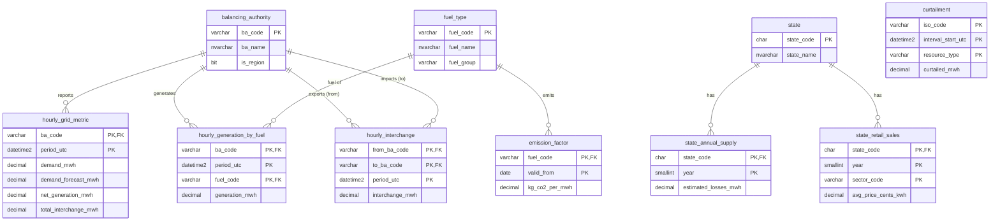

# US Electricity Grid & Energy Waste Analytics

**When and where is US electricity clean, reliable, and wasted?**

An end-to-end analytics project built on official US government energy data: an automated Python pipeline loads hourly grid data into a layered SQL Server database, and a Power BI dashboard turns it into decisions about grid stress, carbon intensity, and electricity wastage.

> Status: 🚧 In progress. Milestone 1 (database + ingestion pipeline) complete.

## Why this project

AI data centers and EV charging are pushing US electricity demand up fast. Utilities, grid operators, and tech companies need to know where the grid can take new load, when power is cleanest, and how much energy is lost before it reaches anyone. This project answers those questions with hourly data across 60+ US grid regions.

## Key features

| Feature | Question it answers |
|---|---|
| **Grid Stress Index** (original metric) | Which regions are closest to their limits, combining peak demand, import dependence, and forecast error? |
| **Hourly carbon intensity** | How much CO₂ does each kWh produce, hour by hour, and when is the best time to use power? |
| **Electricity wastage** | How much electricity is lost in transmission and distribution per state, what does it cost in dollars and CO₂, and how much clean solar and wind power is curtailed? |
| **Forecast benchmark** | Can a custom demand forecast beat the EIA’s official day-ahead forecast? |
| Power flow between regions *(optional)* | Which regions export power and which depend on their neighbours during peaks? |

## Architecture

```
EIA Open Data API ──┐
EPA eGRID ──────────┼──► Python pipeline ──► SQL Server
CAISO / ERCOT ──────┘    (paging, retries,    ├── stg   raw text, exactly as received
                          batch logging)      ├── core  typed, normalized, keys + constraints
                                              └── mart  star schema + views
                                                         │
                                       ┌─────────────────┼──────────────────┐
                                       ▼                 ▼                  ▼
                                 SQL analysis     Forecasting model   Power BI dashboard
```

## Core data model



## Design decisions

- **Three database layers.** Staging stores raw text so a malformed value never breaks a download; core enforces types, keys, and `CHECK` constraints; the mart layer is shaped for fast Power BI reporting.
- **Idempotent loads.** Stored procedures `MERGE` each batch into core, so re-running the same date range never creates duplicates.
- **Batch logging.** Every pipeline chunk is recorded in `etl.load_log` with status, row count, and errors, so a failed week can be re-run on its own.
- **Self-registering reference data.** New balancing authorities or fuel codes from the API are added automatically (fuel codes as `UNKNOWN` for review) instead of failing the load.
- **Stable API paging.** Requests are sorted on a unique key so offset-based paging can’t skip or repeat rows.

## Repository structure

```
├── sql/
│   ├── 01_create_database.sql          database + etl/stg/core/mart schemas
│   ├── 02_create_etl_and_staging.sql   load log + raw staging tables
│   ├── 03_create_core_schema.sql       normalized tables, keys, constraints, indexes
│   ├── 04_seed_reference_data.sql      fuel types + emission factors
│   ├── 05_load_procedures.sql          staging → core stored procedures
│   └── 06_data_quality_checks.sql      post-load validation queries
├── python/
│   ├── config.py                       settings from .env
│   ├── eia_client.py                   EIA API client (paging, retries)
│   └── load_eia_hourly.py              pipeline: API → staging → core
├── powerbi/                            dashboard (.pbix) — coming
├── docs/                               ER diagram, screenshots — coming
└── insights/                           business findings — coming
```

## Setup

**Requirements:** Windows (for Power BI Desktop), SQL Server Express + SSMS, Python 3.10+, Microsoft ODBC Driver 18 for SQL Server, and a free EIA API key.

1. Run the SQL scripts `01` → `05` in SSMS, in order.
2. Install Python packages: `pip install -r requirements.txt`
3. Copy `.env.example` to `.env` and add your EIA API key.
4. Load one week first to test:
   ```
   cd python
   python load_eia_hourly.py --dataset all --start 2026-09-01 --end 2026-09-08
   ```
5. Run `06_data_quality_checks.sql` to verify the load.
6. Load the full range (e.g. a year, in weekly chunks):
   ```
   python load_eia_hourly.py --dataset all --start 2025-10-01 --end 2026-10-01
   ```

## Data sources

- **EIA Open Data API**: Hourly Electric Grid Monitor (EIA-930) for demand, day-ahead forecast, net generation, generation by fuel, and interchange; State Electricity Profiles and retail sales for losses and prices.
- **EPA eGRID**: CO₂ emission rates by fuel. *The seed values in `04_seed_reference_data.sql` are approximate placeholders until replaced with eGRID figures.*
- **CAISO and ERCOT**: Public renewable curtailment reports. Curtailment analysis covers these two grids only, since detailed data isn’t published nationally.

All timestamps are stored in UTC.

## Roadmap

- [x] Layered SQL Server database with keys, constraints, and indexes
- [x] Automated EIA ingestion pipeline with batch logging and idempotent loads
- [x] Data quality checks
- [ ] Loaders for state losses, retail prices, and curtailment data
- [ ] Star schema and reporting views (`mart`)
- [ ] Grid Stress Index and carbon-intensity SQL models
- [ ] Wastage analysis (T&D losses and curtailment in MWh, $, and CO₂)
- [ ] Demand forecasting model benchmarked against the EIA forecast
- [ ] Power BI dashboard
- [ ] Business insights and recommendations
